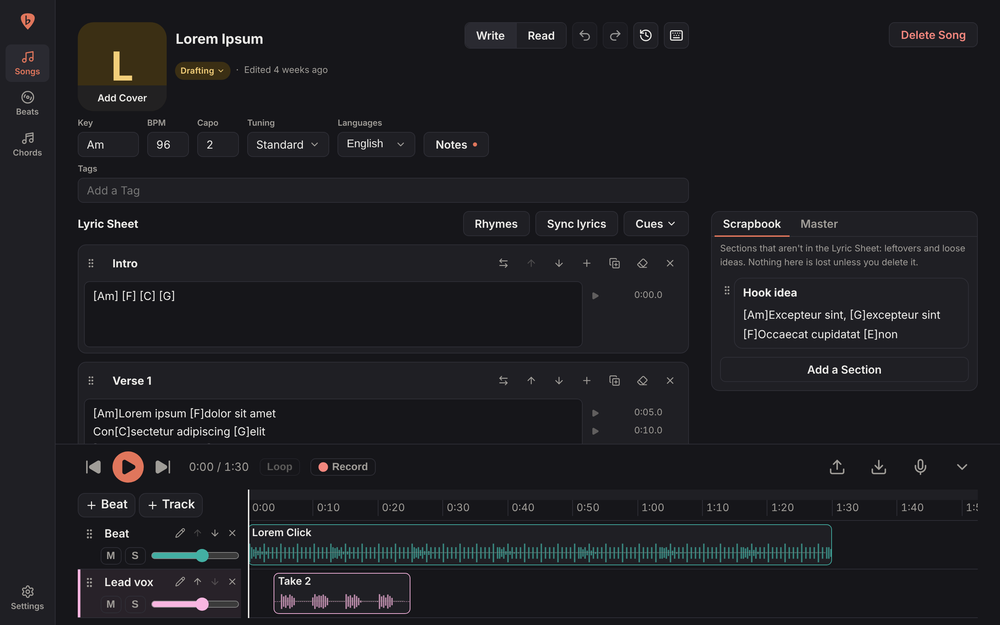

<div align="center">


# Bandmate

**Write songs with chords. Record takes over your beats. Self-hosted.**

[](https://github.com/xKirtle/bandmate/actions/workflows/ci.yml)
[](https://github.com/xKirtle/bandmate/releases/latest)
[](LICENSE)
[](https://xkirtle.github.io/bandmate/)

</div>



Writing a song often means lyrics in a notes app, chords somewhere else, the beat in a browser tab and voice memos scattered across a phone. Bandmate puts them on one page: your lyrics and chords beside a timeline holding the beat and your takes, with each line marked at the moment it's sung.

It's built for one songwriter, and runs on your own machine or homelab. There are no accounts and no subscription, and your Songs stay on your server.

## What it does

- **Write** lyrics with the chords right where you play them. Try a few versions of a verse, and keep the lines that didn't make it.
- **Find** chords on guitar or piano: look one up, name the one under your fingers, or see what fits a key.
- **Listen** to your beats on a multi-track timeline. Upload a beat, or download one from YouTube, SoundCloud or Bandcamp.
- **Sync** your lyrics to the music: tap along to mark when each line starts, and they light up and scroll as the song plays.
- **Record** takes over your beat in the browser, in full quality, and keep every one until you pick one.
- **Read** the song large to play from, with the chords over the words and how to play each one, scrolling on its own if you like.

It's made for a computer or tablet, and most of it works on a phone too. If you'd like to see more, check out the [wiki](https://xkirtle.github.io/bandmate/).

## Quickstart

With Docker Compose, save this as `compose.yaml`, then run `mkdir data && docker compose up -d`:

```yaml
services:
  bandmate:
    image: ${BANDMATE_IMAGE:-ghcr.io/xkirtle/bandmate:latest}
    container_name: bandmate
    restart: unless-stopped
    user: "${PUID:-1000}:${PGID:-1000}"
    ports:
      - "${BANDMATE_PORT:-8080}:8080"
    environment:
      BANDMATE_MAX_UPLOAD_MB: ${BANDMATE_MAX_UPLOAD_MB:-500}
      BANDMATE_UPDATE_CHECK: ${BANDMATE_UPDATE_CHECK:-true}
      BANDMATE_ADD_FROM_LINK: ${BANDMATE_ADD_FROM_LINK:-true}
    volumes:
      - ./data:/data
    healthcheck:
      test: ["CMD", "/bandmate", "healthcheck"]
      interval: 30s
      timeout: 5s
      start_period: 10s
      retries: 3
```

Or with plain Docker:

```sh
mkdir data
docker run -d --name bandmate --restart unless-stopped \
  --user "$(id -u):$(id -g)" -p 8080:8080 -v "$PWD/data:/data" \
  ghcr.io/xkirtle/bandmate:latest
```

Then open http://localhost:8080.

To run it without Docker, from a ready-made binary or one you build yourself, see [Without Docker](https://xkirtle.github.io/bandmate/self-hosting#without-docker) in the self-hosting guide.

> [!WARNING]
> Bandmate has no login: anything that can reach it can read and change every Song. Anywhere beyond your own machine, put it behind a reverse proxy that handles HTTPS and authentication. Recording also needs HTTPS, or localhost, for the microphone.

Configuration, updating and the rest are in the [self-hosting guide](https://xkirtle.github.io/bandmate/self-hosting).

## Learn more

- [Wiki](https://xkirtle.github.io/bandmate/): every feature, and how to self-host Bandmate
- [Glossary](GLOSSARY.md): the words Bandmate uses, in the code and the UI alike
- [Roadmap](docs/roadmap.md) and [release notes](https://github.com/xKirtle/bandmate/releases): what might come next, and what each version shipped
- [Contributing](CONTRIBUTING.md): reporting bugs, sharing ideas, and building Bandmate
- [Security policy](SECURITY.md): reporting a vulnerability

Bandmate is developed with heavy AI assistance, held to the same rules as every contribution: see [Contributing](CONTRIBUTING.md).

## License

[GNU Affero General Public License v3.0](LICENSE). If you run a modified Bandmate as a service that others use over a network, you must offer them its source code.

Bandmate also includes these, each under its own license, as the [self-hosting guide](https://xkirtle.github.io/bandmate/self-hosting#licenses) lists:

- **Programs in the image**: yt-dlp, ffmpeg and QuickJS.
- **Piano recordings**: the [Salamander Grand Piano](https://github.com/Tonejs/audio/tree/master/salamander) by Alexander Holm ([CC BY 3.0](https://creativecommons.org/licenses/by/3.0/)), trimmed and re-encoded.
- **Guitar recordings**: the [University of Iowa Electronic Music Studios](https://theremin.music.uiowa.edu/MIS.html), [Musical Instrument Samples](https://theremin.music.uiowa.edu/MISguitar.html) (Raimundo 118, Brian Penkrot, 2011), trimmed, retuned and re-encoded.
